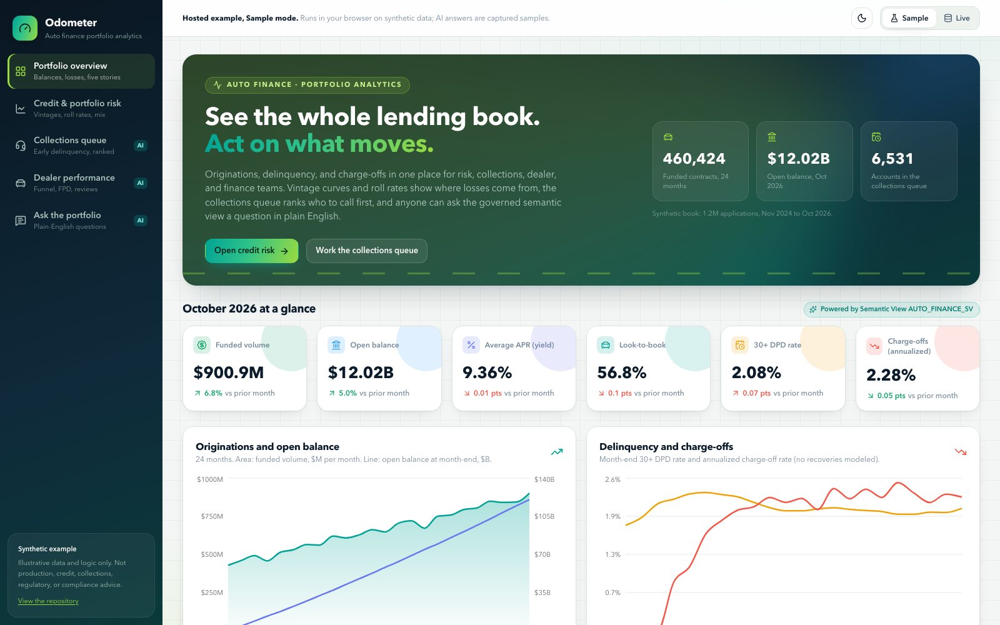

# Auto Finance Portfolio Analytics

**See the whole auto lending book on one governed semantic layer, from originations to delinquency, vintage losses, collections, and dealer performance. Act on what moves.**

At an auto lender, the credit risk, collections, dealer, and finance teams each watch a different slice of the same loans, and each defines delinquency and charge-offs slightly differently. This example ("Odometer") puts them on one Snowflake semantic view over contract-level data:

- vintage curves and roll rates that show where losses come from
- a collections queue ranked by a transparent roll-risk score
- dealer first-payment-default monitoring
- plain-English questions

AI summaries suggest a next step, and a person makes the decision.

- **Guide:** https://sfc-gh-ooral.github.io/sfguide-auto-finance-portfolio-analytics/
- **Try it in your browser (no account):** https://sfc-gh-ooral.github.io/sfguide-auto-finance-portfolio-analytics/try/

> **Synthetic data, illustrative logic.** Every dealer, borrower, and number is generated by this repository. Not production, credit, collections, regulatory, or compliance advice.



## What's inside

| Screen | What it shows | Snowflake capability |
|---|---|---|
| Portfolio overview | October 2026 KPIs (funded volume, open balance, APR, look-to-book, 30+ DPD, annualized charge-offs), 24-month trends, five planted findings | Semantic View |
| Credit & portfolio risk | 30+ DPD by FICO band, cumulative charge-offs by vintage, a segment check, roll-rate matrix, origination mix | Semantic View over month-end payment rows |
| Collections queue | 6,531 accounts 30 to 89 days past due, ranked by roll-risk score; account view with score parts, 12-month status, AI call summary, assign collector or record a promise to pay | `COLLECTIONS_QUEUE` view, AI_COMPLETE (structured output) |
| Dealer performance | 1,500 dealers with funnel, first-payment defaults, and year-over-year decline change; drill-down with AI narrative, exportable brief, and "Flag for review" | AI_COMPLETE (structured output) |
| Ask the portfolio | Plain-English questions with answer, chart, and the SQL that ran | Cortex Agents, Cortex Analyst, verified queries |

The app has two modes, switched in the header:

- **Sample:** bundled deterministic synthetic data. AI answers replay results captured from a Live run, and each is labeled **Sample AI response**. They wait 4 to 8 seconds and show the same steps the Live path runs. Actions are saved in your browser only.
- **Live:** the same screens against the objects that `sql/setup.sql` creates. AI calls show their measured latency, and actions write to Snowflake tables. If a Live call fails, the app shows the error and does not fall back to sample data.

The five planted findings are documented in [data/README.md](data/README.md). On this synthetic data set:

- 30+ DPD in the 580–619 FICO band rises from 4.0% to 10.1% over 12 months, while every other band eases and the origination mix stays flat.
- Used-vehicle 84-month loans booked Feb–Apr 2025 reach 12.0% cumulative charge-offs by month 15, against 2.3% for the same loan type booked in other months.
- Harbor Pre-Owned's first-payment default rate is 22.9% on 2026 contracts, against 1.7% for the book.
- Sunbelt Motors Group's decline rate climbs from 32% to 42% year over year as used-vehicle LTV passes the 120% policy line.
- Weekend look-to-book is about 41%, against about 63% on weekdays.

## Prerequisites

**Sample mode:** Node.js 20 or later. No Snowflake account.

**Live mode:**

- A Snowflake account. Standard Edition works; no masking, row access, or other Enterprise-only features are used.
- Roles:
  - A role that can create roles and grant `SNOWFLAKE.CORTEX_USER`: ACCOUNTADMIN, or USERADMIN plus SECURITYADMIN.
  - SYSADMIN for the objects. SYSADMIN needs `SNOWFLAKE.CORTEX_USER` to create the agent; accounts grant it to PUBLIC by default.
- Cortex Analyst, Cortex Agents, and `AI_COMPLETE` available in your region, or [cross-region inference](https://docs.snowflake.com/en/user-guide/snowflake-cortex/cross-region-inference) enabled. Summaries and narratives use `claude-sonnet-4-5` by default; set `SNOWFLAKE_COMPLETE_MODEL` to any model your region offers.
- All features used are generally available. No preview features are required.

Tested in November 2026 with Next.js 16.3, Node.js 22, and snowflake-sdk 3.4 in AWS US East 1 (N. Virginia).

## Quick start (Sample mode)

```bash
git clone https://github.com/sfc-gh-ooral/sfguide-auto-finance-portfolio-analytics
cd sfguide-auto-finance-portfolio-analytics
npm install
npm run dev
```

Open http://localhost:3000. Without `.env.local`, the app runs in Sample mode.

## Live mode: deploy to your account

1. **Create the objects.** Open `sql/setup.sql` in a Snowsight SQL worksheet and run it top to bottom. No edits or find-and-replace are needed. It takes about a minute on XSMALL. The check queries at the end should return 1,200,000 applications, 460,424 funded contracts, and 6,531 accounts in the collections queue.
2. **Create a key pair** outside the repository and register the public key on your user:
   ```bash
   mkdir -p ~/.snowflake/keys
   openssl genrsa 2048 | openssl pkcs8 -topk8 -inform PEM -out ~/.snowflake/keys/auto_finance_key.p8 -nocrypt
   openssl rsa -in ~/.snowflake/keys/auto_finance_key.p8 -pubout
   ```
   ```sql
   ALTER USER <YOUR_USER> SET RSA_PUBLIC_KEY_2 = '<public key body without header lines>';
   ```
3. **Configure the app.** Copy `.env.example` to `.env.local` and fill in `SNOWFLAKE_ACCOUNT`, `SNOWFLAKE_USERNAME`, and `SNOWFLAKE_PRIVATE_KEY_PATH`. The role defaults to the least-privilege `AUTO_FINANCE_DEMO_ROLE`. `.env.local` is gitignored; never commit it.
4. **Run it.** Run `npm run dev`, then pick **Live** in the header. It defaults to Live when a connection is configured. The app never asks for credentials in the browser.
5. **Clean up.** Run `sql/cleanup.sql` when you're done. It drops everything setup created.

Optional: refresh the captured answers that Sample mode replays. With the app running in Live mode, run `node scripts/capture-live.mjs` with `APP_URL` set to the app's address.

### Objects created

| Object | Name | Notes |
|---|---|---|
| Role | `AUTO_FINANCE_DEMO_ROLE` | Least privilege: reads the example data, inserts into the two app tables, and uses the semantic view and agent. Granted to you and to SYSADMIN. |
| Warehouse | `AUTO_FINANCE_WH` | XSMALL, `AUTO_SUSPEND = 60`, starts suspended |
| Database / schema | `AUTO_FINANCE_EXAMPLE.LENDING` | Everything below lives here |
| Functions | `HASH32`, `HASH32_STEP2` | Deterministic integer hash used by the generator |
| Tables | `DEALERS` (1,500), `APPLICATIONS` (1.2M), `CONTRACTS` (460K), `PAYMENTS_MONTHLY` (4.6M), `DEALER_TARGETS` (36K) | Synthetic, deterministic |
| Tables | `COLLECTION_ACTIONS`, `DEALER_REVIEWS` | Written by the app: collector assignments, promises to pay, and dealer reviews |
| Views | `DEALER_MONTHLY`, `COLLECTIONS_QUEUE` | Funded units against target; early-delinquency accounts with roll-risk score |
| Semantic view | `AUTO_FINANCE_SV` | 5 logical tables, 17 metrics, 25 dimensions, 7 verified queries |
| Cortex Agent | `AUTO_FINANCE_AGENT` | Tool: Cortex Analyst on `AUTO_FINANCE_SV` |

The ACCOUNTADMIN path appears only in the first block of `setup.sql`, which creates the role and grants `CORTEX_USER`. Everything else runs as SYSADMIN, and the app runs as `AUTO_FINANCE_DEMO_ROLE`.

### Expected cost and time

- **Setup:** about one minute of XSMALL warehouse time, well under 0.05 credits.
- **Using the app:** each Ask question, account summary, or dealer narrative is one Cortex Agent or AI_COMPLETE call, billed per token. In testing, Ask took about 8 to 22 seconds and summaries about 5 seconds. See the [Snowflake Service Consumption Table](https://www.snowflake.com/legal-files/CreditConsumptionTable.pdf) for current rates.
- **While it exists:** only storage for about 6 million small rows. The warehouse suspends after 60 seconds idle. Run `sql/cleanup.sql` when you're done.

## Known limitations

- **Sample mode replays captured answers.** It answers the seven suggested questions exactly as a Live run did. Other questions get the closest captured answer, with a note saying so. Captured AI summaries cover the top eight queue accounts and five dealers, including Sunbelt Motors Group and Harbor Pre-Owned. The rest use a rule-based template grounded in the same facts, still labeled as a sample. Sample mode includes the 400 highest-ranked queue accounts.
- **The roll-risk score is a ranking rule, not a credit model.** It adds points for days past due, FICO band, LTV, term, and loan age, and it is the same in SQL and the app. Replace it with your own segmentation or model before relying on it.
- **Losses are simplified.** Charge-offs are the balance at charge-off, with no recoveries, fees, or interest accrual modeled. The delinquency path per contract follows a fixed pattern (current, 30, 60, 90+, then cure or charge-off).
- **Verified queries help, but answers can vary.** In the capture run, five of the seven suggested questions used a verified query. Agent wording and occasional SQL can vary between runs, so each answer shows the SQL it ran.
- **SQL wrappers, not streaming APIs.** The app calls the agent through `SNOWFLAKE.CORTEX.DATA_AGENT_RUN`, so it needs only one SQL connection. Production apps would typically use the streaming Cortex Agents REST API.
- **Decisions are recorded, not executed.** Assignments, promises to pay, and dealer reviews write a row to a table (Live) or browser storage (Sample). Nothing contacts a borrower or changes a dealer's setup.

## Customize with Cortex Code

- "Map my loan and payment tables to the CONTRACTS and PAYMENTS_MONTHLY shapes as views. Don't change any source objects."
- "Add our roll-rate and charge-off definitions to the semantic view, then generate verified queries and run the eval."
- "Replace the roll-risk points with our collections segmentation, and show me the SQL before you deploy it."

## How it's built

- **Stack:** Next.js (App Router), TypeScript, Tailwind CSS, Recharts, and lucide-react. Live mode uses `snowflake-sdk`, with bind variables for every user-supplied value.
- **Data layer:** `lib/source.ts` defines the interface. Sample mode implements it in `lib/sample-source.ts` (bundled JSON and captured results). Live mode uses the API routes in `app/api/`, via `lib/live-queries.ts` and `lib/agent.ts`.
- **Synthetic data:** `npm run generate` rebuilds the data and the dealer rows in `sql/setup.sql`. Sample and Live numbers match exactly because both use the same integer hash. This was checked field by field against a Live run for every aggregate, dealer, and queue account.
- **Hosted example and images:** `npm run build:example` exports the in-browser example to `docs/try/`. `npm run capture` refreshes the screenshots in `docs/images/` and the catalog cards in `docs/catalog/`.

## License and disclaimer

Licensed under the [Apache License 2.0](LICENSE). See [LEGAL.md](LEGAL.md).

This is an illustrative example provided as-is. It is not an official Snowflake product and is not supported by Snowflake Support. It contains no customer data. Review and test before any production use.

Owner: Oz Oral · Last reviewed: November 2026
